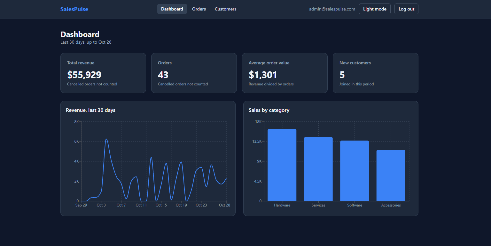
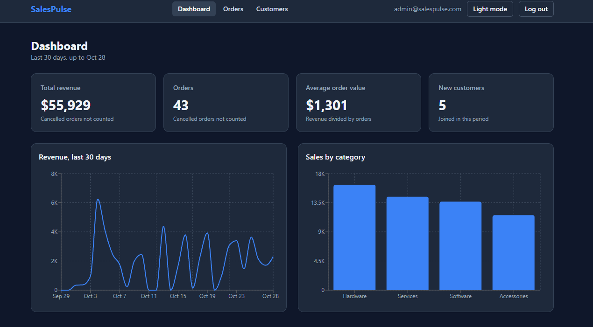
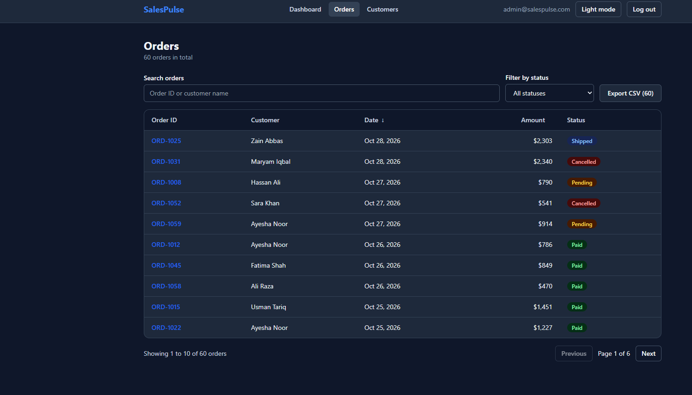
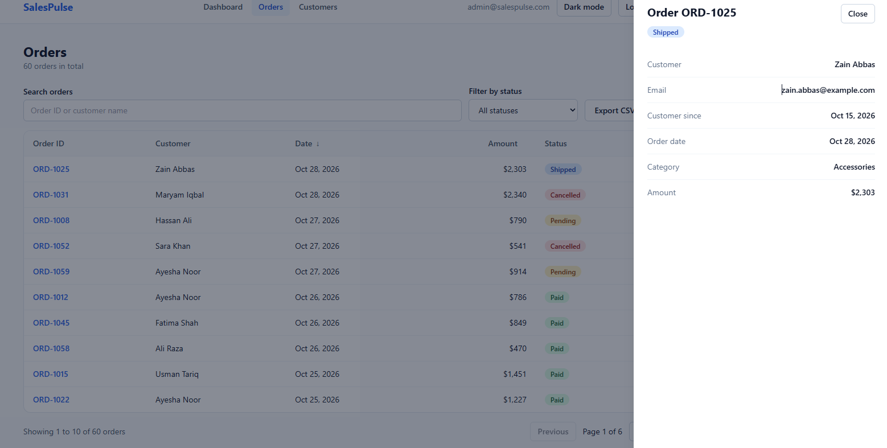
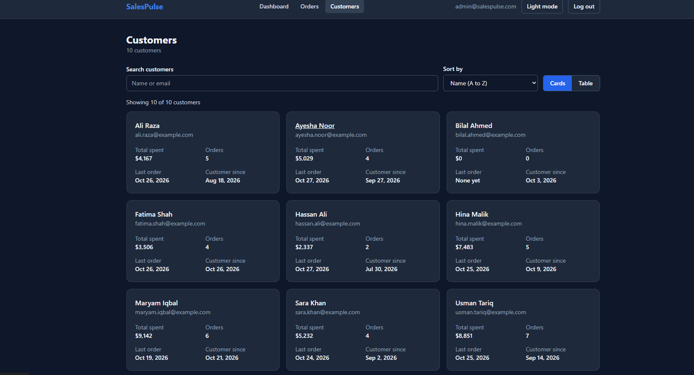
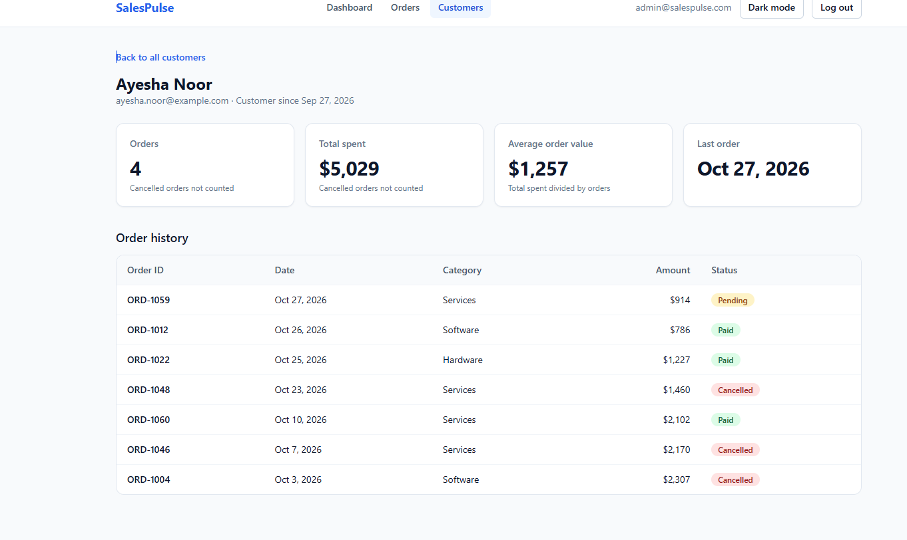

# SalesPulse

An internal sales dashboard. The sales team can see revenue at a glance, browse and search orders, and look up any customer with their order history.

It is a frontend-only project. The backend is not ready, so it works with a fake API (`mock/db.json`). The data layer is isolated in `src/api`, so the real API can replace it later.

**Live demo:** `https://YOUR-APP.vercel.app` (replace this link after you deploy, see [Deployment](#deployment))

**Demo login:** `admin@salespulse.com` / `Admin@123`

## Screenshots

| Dashboard | Dashboard in dark mode |
| --- | --- |
|  |  |

| Orders | Order details |
| --- | --- |
|  |  |

| Customers | Customer detail |
| --- | --- |
|  |  |

## Features

**Login**
- Email and password form with validation and clear error messages
- Protected routes: logged-out visitors are sent to the login page, then back to the page they wanted
- The session survives a page refresh, and Log out clears it

**Dashboard**
- Four KPI cards: total revenue, orders, average order value, new customers (last 30 days)
- Line chart of daily revenue and bar chart of sales by category
- Loading skeletons, and an error message with a Retry button when the API is down

**Orders**
- Table with order ID, customer, date, amount and status badge
- Search by order ID or customer name, filter by status, sort by any column
- Pagination (10 orders per page)
- Click a row to open a side panel with the order details and customer email
- Export to CSV (every order that matches the current search and filter)

**Customers**
- Card view and table view, with search and sorting
- Customer detail page: total spent, order count, average order, last order, and the full order history
- A friendly "Customer not found" page for a wrong link

**Everywhere**
- Light and dark mode. It remembers your choice and follows your computer setting the first time
- Responsive: works on phone, tablet and desktop
- Keyboard accessible: skip link, visible focus ring, sort state announced with `aria-sort`, current page marked in the menu, side panel closes with Escape
- Respects the "reduce motion" setting

## Tech stack

| Part | Tool |
| --- | --- |
| App | React 18, TypeScript, Vite |
| Styling | Tailwind CSS 3 |
| Routing | React Router 6 |
| Data fetching | TanStack Query |
| Charts | Recharts |
| Fake API | json-server |
| Tests | Vitest, React Testing Library, user-event |

## Getting started

You need [Node.js](https://nodejs.org) 18 or newer.

```
npm install
```

Then start the fake API and the app in **two terminals**:

```
npm run api      # fake API on http://localhost:3001
npm run dev      # app on http://localhost:5173
```

Open http://localhost:5173 and log in with the demo account.

If the API is not running, the Dashboard, Orders and Customers pages show an error with a **Retry** button. Start `npm run api` and press Retry.

## Scripts

| Command | What it does |
| --- | --- |
| `npm run dev` | Starts the app in development mode |
| `npm run api` | Starts the fake API (60 orders, 10 customers) |
| `npm run test` | Runs all tests once |
| `npm run build` | Checks the types, copies the data to `public/data`, and builds `dist/` |
| `npm run preview` | Serves the built site on http://localhost:4173 |

## How the data works

| Where | Data comes from |
| --- | --- |
| Development (`npm run dev`) | The fake API: `GET /orders`, `GET /customers` on port 3001 |
| Deployed site or `npm run preview` | JSON files in `/data`, made from `mock/db.json` during `npm run build` |

A static host such as Vercel cannot run `npm run api`, so the production build reads plain JSON files instead. The switch is the `VITE_STATIC_DATA` setting in `.env.production`, and it is handled in `src/api/client.ts`.

**To connect the real API later:** set `VITE_API_URL` to its address, remove `VITE_STATIC_DATA`, and adjust the small files in `src/api/` if the response shapes differ.

## Project structure

```
src/
  api/          fetch helper and one file per resource
  components/   shared UI, with folders for dashboard, orders and customers
  context/      AuthContext (login) and ThemeContext (dark mode)
  hooks/        useOrders and useCustomers (TanStack Query)
  lib/          plain logic: stats, orders, customers, format, auth, download
  pages/        one file per screen
  test/         test setup, fake data and render helpers
mock/db.json    fake data
scripts/        export-static-data.mjs (copies the fake data for deployment)
```

The business logic lives in `src/lib` as plain functions, so it is easy to test without a browser.

## Testing

```
npm run test
```

The tests cover:
- **Logic:** revenue and KPI math, filtering, sorting, pagination, CSV export, customer totals
- **Pages:** loading, error with Retry, empty states, search, filters, view switching
- **Login and routes:** validation, wrong password, protected routes, log out
- **Dark mode:** switching, saving, and following the system setting
- **A full user journey:** login, dashboard, orders, customers, customer detail, log out

`src/test/setup.ts` adds small stand-ins for `localStorage` (newer Node versions have an empty one that hides the browser version) and `ResizeObserver` (needed by the charts).

## Deployment

### Vercel

1. Push the project to GitHub.
2. On [vercel.com](https://vercel.com), choose **Add New**, then **Project**, and import the repository.
3. Vercel detects Vite. The build command is `npm run build` and the output folder is `dist`. Leave the defaults.
4. Click **Deploy**.
5. Copy the live link into the top of this README.

`vercel.json` makes page refreshes and direct links (like `/customers/c1`) work.

### Netlify

Build command `npm run build`, publish directory `dist`. The file `public/_redirects` handles page refreshes.

### Try the production build on your computer

```
npm run build
npm run preview
```

Open http://localhost:4173. It works without `npm run api`.

## Decisions and assumptions

| Topic | Decision |
| --- | --- |
| "Last 30 days" | Counted back from the newest order, not from today. This keeps the fake data useful at any date. With a real API, pass today's date to `getReferenceDate` in `DashboardPage`. |
| Cancelled orders | Not counted in revenue, order counts or customer totals. They still appear in lists with a Cancelled badge. |
| CSV export | Exports every order that matches the current search and filter, in the current sort order, not only the current page. Text starting with `=`, `+`, `-` or `@` gets a leading apostrophe so spreadsheets do not run it as a formula. |
| Search, filter, sort, paging | Done in the browser on the full list. Fine for hundreds of orders. With a big real API this should move to the server. |
| Login | A demo. The password is checked in the browser, so it is **not secure**. Replace it with real authentication when the API is ready. |

## Roadmap

- Date range picker for the charts
- Notifications dropdown
- Real API and real authentication
- Server-side search and paging
